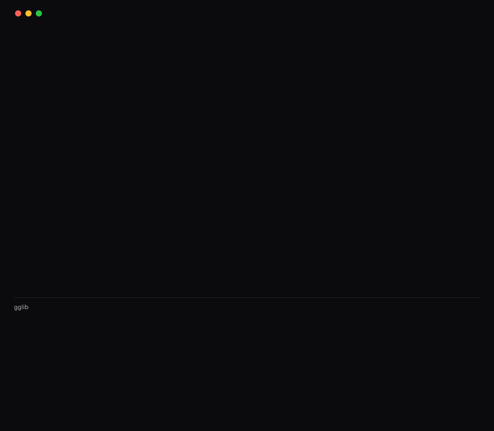
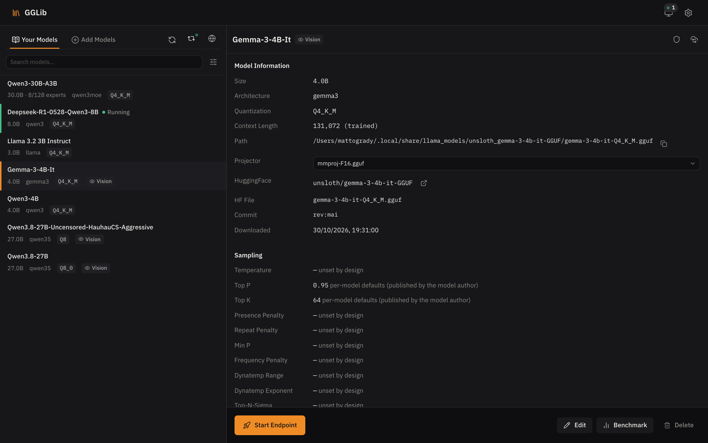
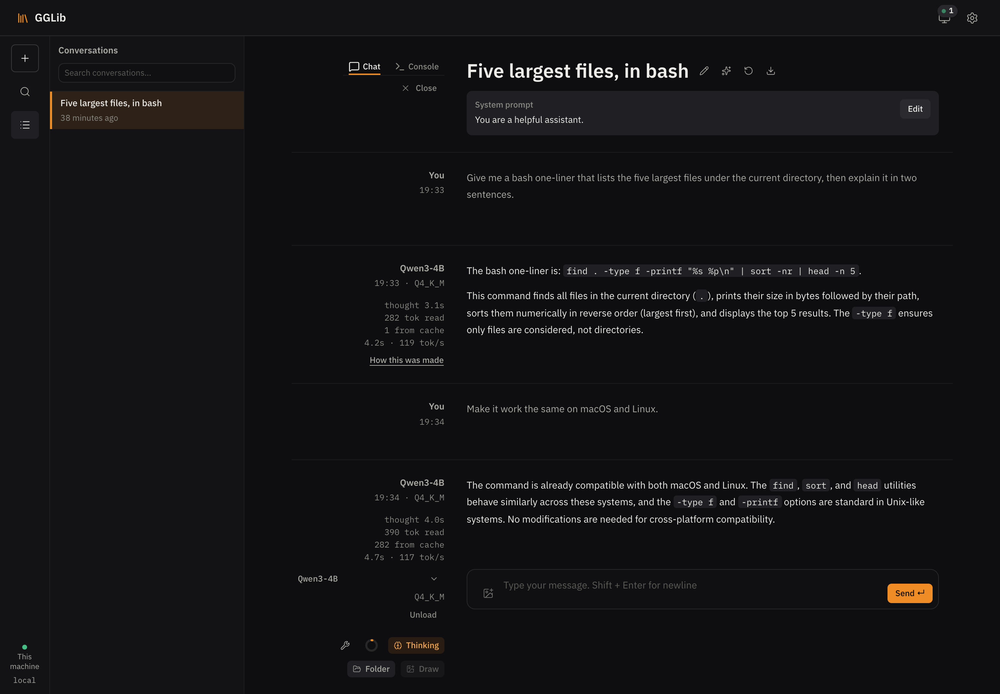
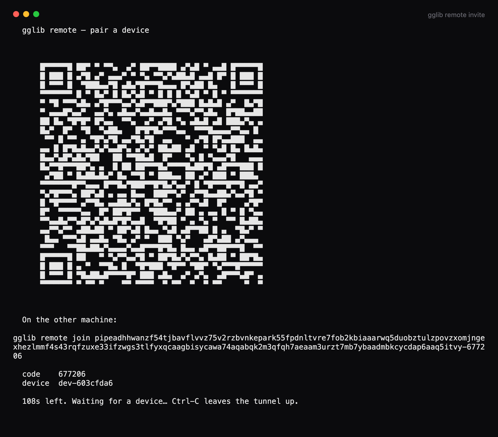
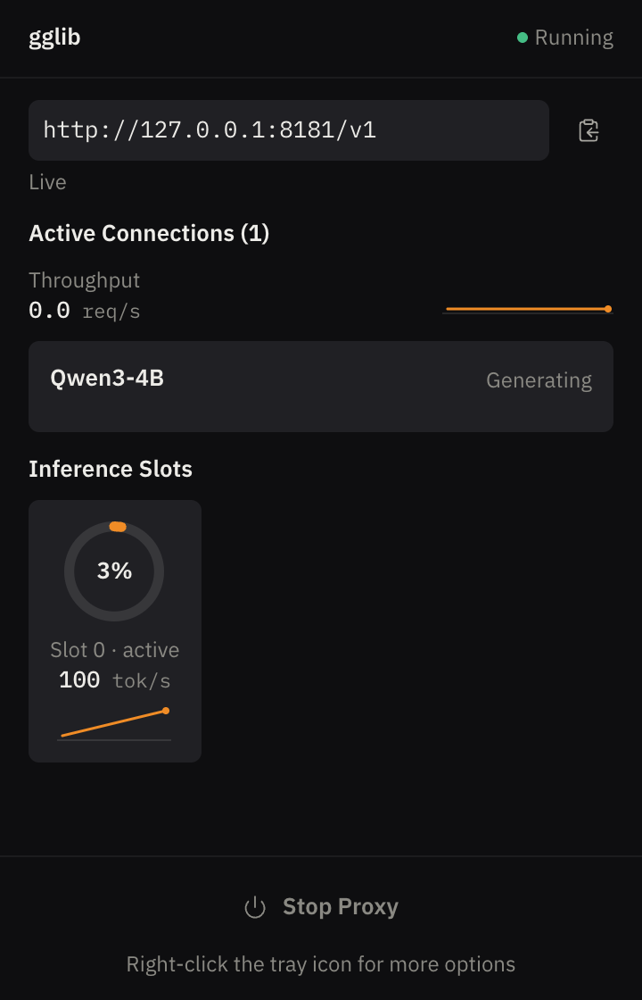

# GGLib

[](https://github.com/mmogr/gglib/actions/workflows/ci.yml)
[](https://github.com/mmogr/gglib/actions/workflows/coverage.yml)

[](LICENSE)

**The local model runtime that makes llama.cpp behave like an API provider.**  
Every GGUF you own, as one endpoint, on every device you own.

Running llama.cpp directly gives you the current engine and every flag.
It also gives you the chores: launch flags that differ per model, the right
chat template, the right sampling, GGUFs spread across folders, a client
that wants a different setup every time, and nothing that reaches your
phone.

gglib does those chores. It reads each GGUF and launches llama-server the
way you would have, keeps your models as a library, and serves the whole
library as one OpenAI-compatible endpoint. `gglib remote` puts that
endpoint on your other machines and your phone over an encrypted
peer-to-peer link, with no VPN and no account.

It is still llama.cpp. Every sampling value gglib resolves is shown with the
layer that set it, and you can override any of them per model, per profile
or per request.

<p align="center">
  
</p>

## Two minutes

```bash
brew install mmogr/tap/gglib        # macOS (Apple silicon) and Linux
sudo apt install gglib              # Ubuntu 24.04+, Debian 13+ (repository below)
gglib up
```

`gglib up` reads your hardware, installs llama.cpp and the image runtime if
they are missing, recommends a model that fits, starts the proxy, sends one real request
through it to prove it works, and prints the settings to paste into your
client. Already have GGUFs? `gglib model add <file>` puts them in the library
as they are, wherever they live.

The endpoint is `http://127.0.0.1:8080/v1`. Every model in the library is on
`/v1/models`; ask for one and gglib loads it, ask for another and it swaps.
No API key is needed on loopback; use any placeholder if your client insists.

| Client | Setup |
|--------|-------|
| **Cline / Roo Code** | API Provider *OpenAI Compatible*, Base URL `http://127.0.0.1:8080/v1`, API Key `gglib`, Model ID from `gglib model list` |
| **Continue** | `config.yaml`: provider `openai`, apiBase `http://127.0.0.1:8080/v1` |
| **Aider** | `OPENAI_API_BASE=http://127.0.0.1:8080/v1 OPENAI_API_KEY=gglib aider --model openai/<model>` |
| **opencode** | `opencode.json`: an `@ai-sdk/openai-compatible` provider, baseURL `http://127.0.0.1:8080/v1`, one entry per model ([example](docs/clients.md#opencode)) |
| **Zed, Copilot, Open WebUI, anything else** | [docs/clients.md](docs/clients.md) |

<p align="center">
  
</p>

Binaries for macOS, Linux and Windows, the desktop app, and the build from
source are under [Install](#install).

## A library

<p align="center">
  
</p>

Every GGUF you own in one place, with what gglib read from it: size,
architecture, quantization, trained context, whether it sees images, and
tags for whether it reasons and how its chat template writes tool calls.
Download from Hugging Face by repository name
(`gglib model download unsloth/Qwen3-4B-GGUF`, pick a quant with `-q`),
search and browse the hub, verify hashes, and upgrade a model when its
repository publishes a newer file. A download that comes with a projector
links it, so the model can read images from day one.

The inspector on the right is the control staying in your hands: each
sampling value, the layer it came from (request, profile, this model, your
global default, or the recipe the model's author published), and a form to
override any of them. [Sampling →](docs/sampling.md)

## One endpoint

What runs between the client and llama-server is most of the product. In
order of how often it matters:

- **Launch flags from metadata.** Context size fitted to the model and this
  machine, `q8_0` KV cache, Jinja templating, speculative decoding where the
  GGUF carries an MTP head, the projector when the model has one. No
  per-model config file. [Details →](docs/tags.md)
- **Capability detection.** At import, gglib renders the chat template
  against probe conversations to learn whether the model reasons, how it
  writes tool calls, and whether it reads `reasoning_effort`. Clients get
  strict OpenAI-format events whatever dialect the model speaks (Qwen XML
  tool calls, bare `<think>` tags). [Details →](docs/tags.md#format-dialect-tags)
- **Sampling authority.** Request → profile → per-model → global → the
  model's own recipe. Client values are untrusted by default, so no request
  silently overrides your configuration. Append `:coding` to a model name
  to pick a profile. [Details →](docs/sampling.md)
- **Tool-call repair.** A malformed tool call from the model is validated
  against the client's schema and re-issued under llama.cpp's grammar before
  the client sees it. Through a real proxy on Llama 3.2 3B, 11 of 11
  re-issues produced a conformant call; on Qwen3.8-27B nothing broke a schema
  and repair never fired. [Details →](docs/tool-call-repair.md)
- **Loop defence.** Agentic clients replay the whole conversation each turn,
  so the proxy spots tool-call batches repeated with the same answers and
  repeated response text, and tells the model what it has repeated; a run
  that trips again is ended with a reply that calls no tool.
  [Details →](crates/gglib-proxy/README.md#loop--stagnation-defence)
- **Context defence.** Oversized tool and assistant messages are truncated
  before forwarding, scaled to the model's real context, because most
  clients do not compact for custom endpoints.
  [Details →](crates/gglib-proxy/README.md#history-truncation)
- **KV cache tiering.** Quantized KV in VRAM, a host-RAM prompt cache sized
  from your memory on every launch, and opt-in disk slots that survive model
  swaps and restarts. [Details →](docs/cache.md)
- **Admission control.** Alternating models (chat plus embeddings) batch
  their swaps instead of thrashing.
  [Details →](crates/gglib-runtime/src/process/admission/README.md)
- **Images.** A screenshot pasted into a client goes to a model linked to
  its projector, is counted against the context by its pixels, and is
  refused by name on a model that cannot see, before anything is loaded.
  [Details →](docs/clients.md#images)

<p align="center">
  
</p>

The chat page is the quickest way to try a model, and it shows what every
reply cost: thinking time, tokens read, how many came from cache, and
generation speed. Tools come from MCP servers you add; a folder you choose
for a chat is readable by its file tools, read-only, and nothing outside it is.

## Every device

Your desktop has the GPU; your laptop, and your phone, have the question.

```bash
# desktop
gglib remote enable --invite          # a ticket and a six-digit code, shown once

# laptop, within two minutes
gglib remote join <ticket>-<code>     # a local port here is now the desktop's proxy
gglib q --remote -m <model> "Why is this test flaky?"
```

<p align="center">
  
</p>

The connection is direct and end-to-end encrypted, from
[modelpipe](https://github.com/mmogr/modelpipe): no port forwarding, no VPN,
no account, no relay that can read a request. The code is single-use and
dies in two minutes; the tunnel enforces the same API key the proxy does.
On the laptop, the chat page lists the desktop's conversations beside its
own and carries them on live. [Details →](docs/remote.md)

On an iPhone or iPad, [ggchat](https://github.com/mmogr/ggchat) scans the
same QR code and talks to the same endpoint; it is a native iPhone and Mac
app.

The desktop app doubles as an always-on host: `--proxy-autostart`,
`--close-to-tray` and `--start-at-login` keep the endpoint up without a
terminal window, and the tray shows what it is doing.

<p align="center">
  
</p>

## Day to day

```bash
gglib model download unsloth/Qwen3-4B-GGUF -q Q4_K_M
gglib model search "gemma 3 instruct"
gglib model list
gglib model explain Qwen3-4B          # every resolved parameter and which layer set it

gglib chat Qwen3-4B                    # interactive
gglib q "Explain the builder pattern in Rust"
cat error.log | gglib q "What went wrong here?"
gglib q --image shot.png "what is the error?"

gglib serve Qwen3-4B                   # the same proxy, pinned to one model
gglib proxy dashboard                  # live connections, slots, cache, in the terminal
```

Settings are optional and persist:

```bash
gglib config settings set --default-context-size 131072
gglib config settings set --proxy-autostart true --close-to-tray true
```

`gglib benchmark` compares models on one prompt, measures throughput, and
sweeps sampling parameters for a model with `--apply` to keep the winner.
[CLI reference →](docs/cli.md)

## Interfaces

All of them share one database and one models folder.

| Interface | Command | Details |
|-----------|---------|---------|
| OpenAI proxy | `gglib proxy` | [gglib-proxy](crates/gglib-proxy/README.md) |
| Pinned endpoint | `gglib serve <model>` | Same proxy, one model |
| CLI | `gglib <command>` | [gglib-cli](crates/gglib-cli/README.md) |
| Desktop app | `gglib gui` | [src-tauri](src-tauri/README.md) |
| Web UI | `gglib web` | [gglib-axum](crates/gglib-axum/README.md) |
| Terminal dashboard | `gglib proxy dashboard` | Connections, slots, cache, requests |
| Remote access | `gglib remote enable` / `join` | [docs/remote.md](docs/remote.md) |
| Phone | [ggchat](https://github.com/mmogr/ggchat) | iPhone and Mac |

## Where the work is going

This card is drawn each morning from the repository's record: what is current, how often it ships, and where the work has gone.

<picture>
  <source media="(prefers-color-scheme: dark)" srcset="https://raw.githubusercontent.com/mmogr/gglib/badges/status-dark.svg">
  
</picture>

What each release changed is in [the releases](https://github.com/mmogr/gglib/releases).

## Install

### Homebrew (macOS on Apple silicon, Linux)

```bash
brew install mmogr/tap/gglib
brew install --cask mmogr/tap/gglib-gui   # the desktop app, macOS only
```

### apt (Ubuntu 24.04+, Debian 13+)

```bash
curl -fsSL https://mmogr.github.io/gglib/apt/gglib-archive-keyring.gpg \
  | sudo tee /usr/share/keyrings/gglib-archive-keyring.gpg >/dev/null
echo "deb [signed-by=/usr/share/keyrings/gglib-archive-keyring.gpg] https://mmogr.github.io/gglib/apt stable main" \
  | sudo tee /etc/apt/sources.list.d/gglib.list
sudo apt update && sudo apt install gglib   # the desktop app is gg-lib-gui
```

The repository carries stable releases only; release candidates are on the
[Releases page](https://github.com/mmogr/gglib/releases) as prereleases.

### Pre-built binaries (macOS, Linux, Windows)

Download from the [Releases page](https://github.com/mmogr/gglib/releases)
and run `./gglib up`. The binaries are not code-signed yet:

- **macOS** refuses a file a browser downloaded. Clear the flag with
  `xattr -d com.apple.quarantine ./gglib`, or for the desktop app, after
  dragging it to Applications,
  `xattr -dr com.apple.quarantine "/Applications/GGLib GUI.app"`. The
  desktop app's tar.gz includes `macos-install.command`, which does this,
  and Homebrew does it for you.
- **Windows** SmartScreen stops the desktop app's installer with "Windows
  protected your PC". Choose **More info**, then **Run anyway**.
- **Arch Linux**: AUR packages will follow once the AUR takes new accounts
  again. Until then, the Linux binary or the desktop app's AppImage
  (`chmod +x` it first).

Each release also carries gglib for an iOS or macOS app to link,
`GglibFFI-<version>.xcframework.zip`, its Swift binding in
`GglibFFI-swift-<version>.zip`, and the llama.cpp it runs models with in
`llama-<version>.xcframework.zip`;
[gglib-ffi](crates/gglib-ffi/README.md#release-assets) says what they hold.

### Build from source

Requires Rust, Node.js 20.19+, and a C++ toolchain with CMake.
`gglib config check-deps` prints your platform's exact install commands.

```bash
git clone https://github.com/mmogr/gglib.git && cd gglib
make setup   # checks deps, builds everything, installs the gglib CLI
gglib up
```

`make setup` installs both engines at their pinned releases, llama.cpp for
chat and the image runtime that draws pictures, and offers faster downloads
as an optional extra. It goes on without the image runtime if that install
fails: chat models need only llama.cpp. A build from source keeps its library
in the same per-user folder as an installed gglib;
[CONTRIBUTING](CONTRIBUTING.md#your-data-while-developing) says how to keep a
development build apart.

## Security

Everything binds `127.0.0.1` by default. **Do not expose the endpoint to the
public internet.** An optional bearer API key covers loopback; one is minted
for you if you bind externally, and put on the loopback proxy (the
OpenAI-compatible one on `:8080`, not the daemon's management API on
`:9887`) the moment you enable remote access. The daemon's API asks its own
token, minted at every start and readable only by your account; `gglib web`
opens your browser on a link that carries it (`--no-open` only prints the
link). Host-header allowlist and local-only CORS are always on. No
multi-tenancy or rate limiting. Details in
[gglib-proxy](crates/gglib-proxy/README.md); the tunnel's model is in
[Remote access](docs/remote.md#how-it-stays-private).

Found a vulnerability? Report it privately, as [SECURITY.md](SECURITY.md)
says, not in a public issue.

## Architecture

A Rust workspace (every crate under `crates/`, plus the desktop app in
`src-tauri`) and a React front end. Dependencies point one way: adapters →
facades → infrastructure → `gglib-agent` → core, and
`scripts/check_boundaries.sh` checks part of that in CI. See
[`crates/README.md`](crates/README.md#architecture-overview) for the layer
diagram and the catalog of crates, each with its own README,
[CONTRIBUTING.md](CONTRIBUTING.md) for conventions, and
[generated API docs](https://mmogr.github.io/gglib).

## Documentation

- [CLI command reference](docs/cli.md)
- [Client configuration and images](docs/clients.md)
- [Sampling resolution](docs/sampling.md)
- [Tags & capability detection](docs/tags.md)
- [KV cache tiering](docs/cache.md)
- [Tool-call repair](docs/tool-call-repair.md)
- [Remote access](docs/remote.md)
- [Architecture Decision Records](docs/adr/)
- [Full API docs](https://mmogr.github.io/gglib)

## License

[AGPL-3.0-only](LICENSE). Anyone may use, modify and redistribute gglib,
commercially or not, under its terms: distributing it, or letting users reach
a modified copy over a network, means offering them the corresponding source
under AGPL-3.0. If you cannot meet those terms,
[@mmogr](https://github.com/mmogr) may offer a separate commercial license; ask.

As gglib's copyright holder, [@mmogr](https://github.com/mmogr) also ships
gglib's code inside their own apps under separate terms:
[ggchat](https://github.com/mmogr/ggchat) will link gglib's Rust code to run
models on an iPhone. AGPL-3.0 governs everyone else's use.
